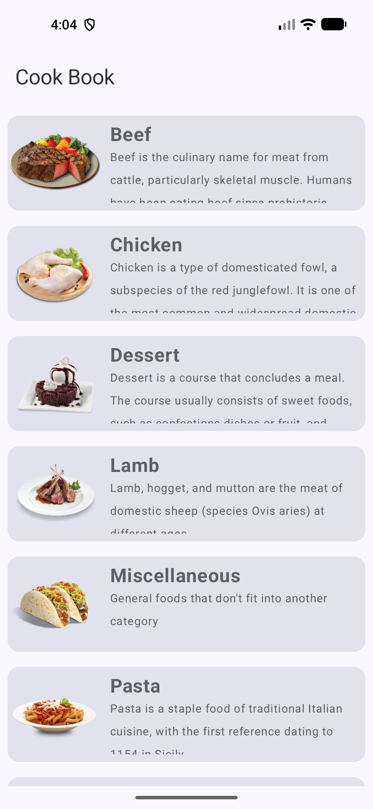

# CookBook

CookBook is an Android app built with Kotlin and Jetpack Compose to explore recipe categories and meal details using TheMealDB API.

## Screenshot



## Features

- Browse recipe categories such as Beef, Chicken, Dessert, Lamb, Pasta, and Miscellaneous
- View meal descriptions and food details
- Modern UI built with Jetpack Compose
- API integration with Retrofit and Gson
- Dependency injection with Hilt
- Local data handling with Room
- Image loading with Coil

## Tech Stack

- Kotlin
- Jetpack Compose
- Hilt
- Retrofit
- Gson
- Room
- Coil
- MVVM + Clean Architecture

## Project Structure

```text
CookBook/
├── app/
│   ├── src/
│   │   ├── main/
│   │   │   ├── java/com/haruvi/cookbook/
│   │   │   ├── res/
│   │   │   └── AndroidManifest.xml
│   │   ├── androidTest/
│   │   └── test/
│   ├── build.gradle.kts
│   └── .gitignore
├── build.gradle.kts
├── gradle.properties
├── gradlew
├── gradlew.bat
├── settings.gradle.kts
├── assets/
│   └── cookbook-home.png
└── README.md
```

## Getting Started

1. Clone the repository:
   ```bash
   git clone https://github.com/harikumar007/CookBook.git
   ```
2. Open the project in Android Studio.
3. Let Gradle sync.
4. Run the app on an emulator or Android device.

## Notes

This project is a sample Android app designed to demonstrate modern Android development patterns, API integration, and Compose-based UI design.

## License

This project currently does not include a license file.
